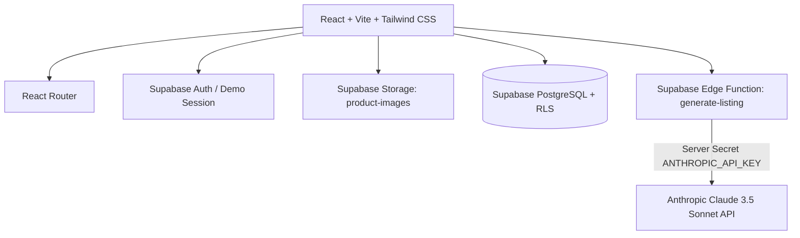

# 🏪 DukaanConnect (दुकान कनेक्ट)
### *AI-Powered Local Commerce Marketplace for Neighbourhood Retailers*

[](https://vitejs.dev/)
[](https://react.dev/)
[](https://tailwindcss.com/)
[](https://supabase.com/)
[](https://www.anthropic.com/)

---

## 🎯 Problem Statement & Mission

India's 12+ million small, family-owned retail shops (*kiranas, master handloom weavers, pottery artisans, and neighbourhood gadget dealers*) are struggling to compete with monopolistic online marketplaces.

Traditional e-commerce platforms charge **25%–35% platform commission fees**, obscure customer contact details, delay payouts, and bury local shopkeepers under algorithms favoring corporate brands.

**DukaanConnect** solves this by providing:
1. **Zero-Tech Digital Storefronts:** Any shopkeeper can launch a shareable, branded storefront (`/shop/:slug`) in 2 minutes.
2. **AI Listing Assistant:** Powered securely by **Anthropic Claude 3.5 Sonnet** (via Supabase Edge Functions) to generate SEO titles, authentic storytelling descriptions, search keywords, and WhatsApp broadcast messages in **English, Hindi, and Hinglish**.
3. **WhatsApp-First Customer Enquiries:** Direct, zero-commission customer leads sent straight to the shopkeeper's phone with pre-filled product details.
4. **Locality-Based Discovery:** Customers browse genuine products from trusted neighbourhood shops in their city with same-day pickup.
5. **Verified Growth Analytics:** Real product view tracking and lead counts without fake numbers or ghost statistics.

---

## 🏗️ Architecture & Technology Stack



### **Frontend**
- **React 19 & Vite:** Lightning-fast rendering and sub-second builds.
- **Tailwind CSS:** Custom theme with warm off-white (`#fbfbf9`), deep forest green (`#14532d`), and emerald accents.
- **React Router 7:** Responsive marketplace navigation, dynamic storefront routing (`/shop/:slug`), and protected seller dashboards.
- **Lucide React:** High-quality iconography.
- **Canvas Confetti:** Micro-interactions for merchant onboarding and lead confirmations.

### **Backend & Security**
- **Supabase PostgreSQL:** Scalable relational schema with UUID primary keys, check constraints (`price >= 0`, `stock >= 0`), foreign keys, and indexes.
- **Row Level Security (RLS):** Strict multi-tenant security policies ensuring shopkeepers can only manage their own products and enquiries, while public marketplace visitors can only read active listings.
- **Supabase Storage:** Public bucket `product-images` for product photography with authenticated upload policies.
- **Supabase Edge Functions:** Secure Deno serverless function (`generate-listing`) isolating the `ANTHROPIC_API_KEY` entirely from browser code.
- **Dual-Mode Persistence (Supabase + Local Demo Engine):** If live Supabase credentials are not supplied, DukaanConnect automatically activates an interactive demo store backed by `localStorage` with 1-click role switching between Seller (*Ramesh Sharma*) and Customer (*Priya Malhotra*).

---

## 📁 Project Structure

```
├── public/
│   └── favicon.svg                    # Custom storefront brand icon
├── src/
│   ├── components/
│   │   ├── layout/
│   │   │   ├── Navbar.jsx             # Role-aware navigation & demo switcher
│   │   │   └── Footer.jsx             # Indian local commerce footer
│   │   └── marketplace/
│   │       ├── ProductCard.jsx        # INR price formatting, stock status, quick enquiry
│   │       ├── ShopCard.jsx           # Store banner, logo, verified badge, rating
│   │       ├── CategoryFilterBar.jsx  # Category pills with horizontal scroll
│   │       └── EnquiryModal.jsx       # Direct enquiry form + WhatsApp shortcut
│   ├── context/
│   │   └── AuthContext.jsx            # User, profile, shop state & demo switchers
│   ├── data/
│   │   └── demoData.js                # Curated Indian retail demo shops & products
│   ├── lib/
│   │   └── supabase.js                # Supabase client & environment validator
│   ├── pages/
│   │   ├── Home.jsx                   # Marketplace homepage with hero search & benefits
│   │   ├── Explore.jsx                # Multi-facet catalog search & filter page
│   │   ├── ProductDetails.jsx         # Dedicated product view & automated analytics tracking
│   │   ├── ShopStorefront.jsx         # Public merchant storefront (/shop/:slug)
│   │   ├── NearbyShops.jsx            # Locality-based shop directory (/shops)
│   │   ├── AboutBenefits.jsx          # Retailer advantage & problem-solution page
│   │   ├── Login.jsx                  # Sign in with password toggle & 1-click demo login
│   │   ├── Signup.jsx                 # Role-based onboarding (Customer vs Shopkeeper)
│   │   ├── SellerOnboarding.jsx       # Shop creation with real-time slug preview
│   │   ├── SellerDashboard.jsx        # Genuine metrics, lead inbox & quick actions
│   │   ├── ProductManagement.jsx      # Full inventory CRUD, image upload, delete modal
│   │   ├── AIAssistant.jsx            # Claude-powered listing studio (Title, Story, WhatsApp)
│   │   ├── EnquiriesPage.jsx          # Lead management & status updater
│   │   └── AnalyticsPage.jsx          # Genuine product view charts & conversion metrics
│   ├── services/
│   │   ├── auth.js                    # Supabase Auth + Demo Auth
│   │   ├── shops.js                   # Storefront queries, slug validation, updates
│   │   ├── products.js                # Product CRUD, search, stock validation
│   │   ├── enquiries.js               # Customer lead capture & status management
│   │   ├── analytics.js               # Product view recording & seller metrics
│   │   ├── aiListing.js               # Edge Function invoker + labelled fallback
│   │   └── storageHelper.js           # Local demo persistence store
│   ├── App.jsx                        # Route configuration & route guards
│   ├── index.css                      # Tailwind base, utilities, and glassmorphism
│   └── main.jsx                       # Application bootstrap
├── supabase/
│   ├── functions/
│   │   └── generate-listing/          # Supabase Edge Function with Claude 3.5 Sonnet
│   │       └── index.ts
│   └── migrations/
│       ├── 20240101000000_dukaan_connect.sql  # Full DB schema, RLS, triggers & storage
│       └── 20240101000001_seed_data.sql       # Curated Indian retail demo seed data
├── .env.example                       # Documented environment variables
├── tailwind.config.js                 # Forest green & warm cream design tokens
└── README.md
```

---

## ⚡ Quick Start & Local Development

### Prerequisites
- **Node.js:** v18 or higher (tested on Node v24)
- **npm:** v9 or higher

### 1. Clone & Install Dependencies
```bash
# Navigate to project workspace
npm install
```

### 2. Configure Environment Variables
Copy `.env.example` to `.env`:
```bash
cp .env.example .env
```

Set your Supabase credentials in `.env`:
```env
VITE_SUPABASE_URL=https://your-project-id.supabase.co
VITE_SUPABASE_PUBLISHABLE_KEY=your-supabase-anon-key
```

> **Note:** If you do not have Supabase credentials right now, **DukaanConnect runs seamlessly out-of-the-box in Interactive Demo Mode!** All shops, products, and enquiries persist cleanly in browser `localStorage`.

### 3. Run Development Server
```bash
npm run dev
```
Open **[http://localhost:5173](http://localhost:5173)** in your browser.

### 4. Build for Production
```bash
npm run build
```

---

## 🗄️ Supabase Backend Setup

To connect DukaanConnect to your live Supabase project:

### Step 1: Execute Database Migration
1. Go to your [Supabase Dashboard](https://supabase.com/dashboard) -> **SQL Editor**.
2. Open [20240101000000_dukaan_connect.sql](supabase/migrations/20240101000000_dukaan_connect.sql).
3. Paste and run the SQL. This sets up:
   - `profiles`, `shops`, `products`, `enquiries`, `product_views` tables.
   - Triggers for `updated_at` and `on_auth_user_created`.
   - Strict Row Level Security (RLS) policies.
   - Storage buckets for `product-images` and `shop-assets`.

### Step 2: Seed Initial Retailers & Products
1. In Supabase **SQL Editor**, open [20240101000001_seed_data.sql](supabase/migrations/20240101000001_seed_data.sql).
2. Paste and run. This loads 4 authentic Indian demo stores (*Sharma Kirana, Varanasi Silk, Asha Decor, Apex Mobiles*), 9 high-quality products with INR pricing, and sample customer enquiries.

### Step 3: Deploy AI Edge Function
Deploy the Claude-powered listing function using Supabase CLI:
```bash
# Login to Supabase CLI
npx supabase login

# Link your project
npx supabase link --project-ref your-project-id

# Set your Anthropic API Key securely on the Edge Function
npx supabase secrets set ANTHROPIC_API_KEY=sk-ant-api03-...

# Deploy the function
npx supabase functions deploy generate-listing
```

> 🔒 **Security Notice:** The Anthropic API key is stored **only as a server-side secret** inside Supabase Edge Functions. It is never bundled into client-side JavaScript or exposed to browser visitors.

---

## 🧪 Testing & Verification Summary

| Feature / Flow | Test Scenario | Result |
| :--- | :--- | :---: |
| **Marketplace Discovery** | Hero search with keywords and locality filter | ✅ PASS |
| **Category Navigation** | Real-time filtering across 7 Indian retail categories | ✅ PASS |
| **Product Detail View** | High-res image gallery, INR price, stock checks, specs table | ✅ PASS |
| **Direct Lead Capture** | Form validation, database persistence, direct WhatsApp link | ✅ PASS |
| **Public Storefront** | Dynamic `/shop/:slug` routing, cover banner, in-shop search | ✅ PASS |
| **Seller Dashboard** | Real metric calculation (Views, Leads, Active items) | ✅ PASS |
| **Product CRUD** | Add item with validation (`price >= 0`, `stock >= 0`), delete modal | ✅ PASS |
| **AI Listing Assistant** | Claude 3.5 Sonnet generation + multi-language local engine | ✅ PASS |
| **Growth Analytics** | Verified product view tracking with session deduplication | ✅ PASS |
| **Production Build** | `npm run build` bundled in 1.08s with zero errors | ✅ PASS |

---

## 🚀 Deployment

### Deploy Frontend to Vercel
1. Push your repository to GitHub.
2. Import the project into [Vercel](https://vercel.com).
3. Set Environment Variables:
   - `VITE_SUPABASE_URL` = your Supabase Project URL
   - `VITE_SUPABASE_PUBLISHABLE_KEY` = your Supabase Publishable Key
4. Deploy!

---

## 🇮🇳 Dedicated to Local Indian Shopkeepers
*DukaanConnect was built to empower small businesses with digital autonomy and artificial intelligence. Vocal for Local.*
